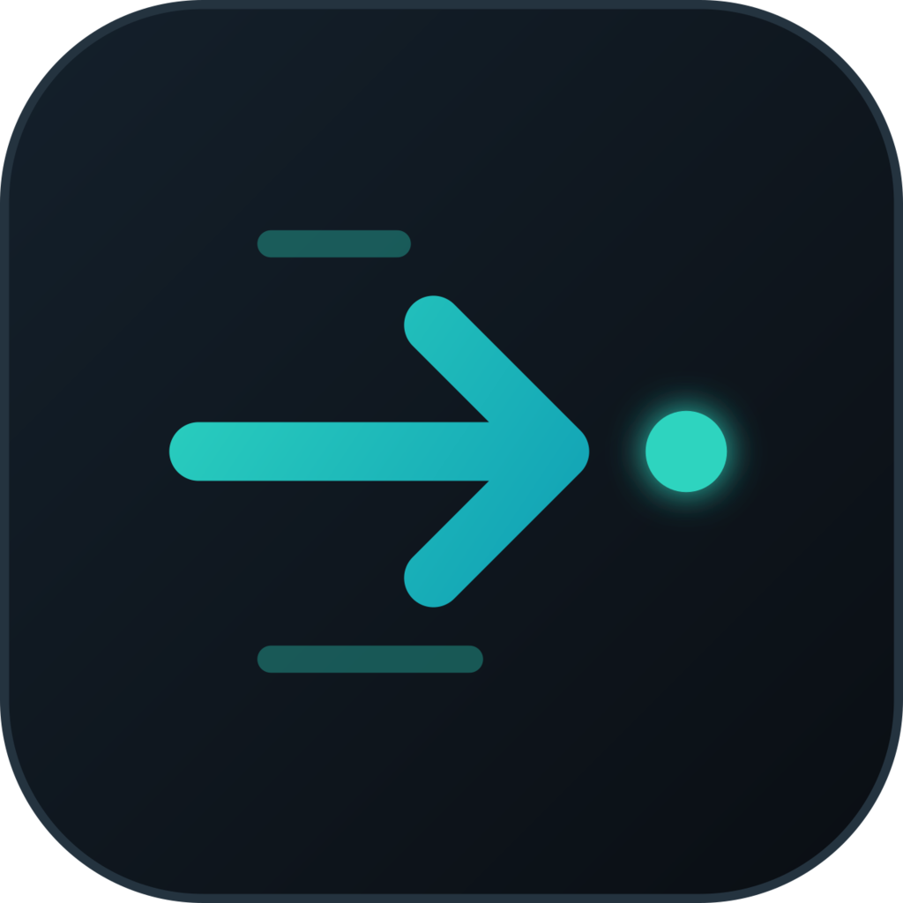
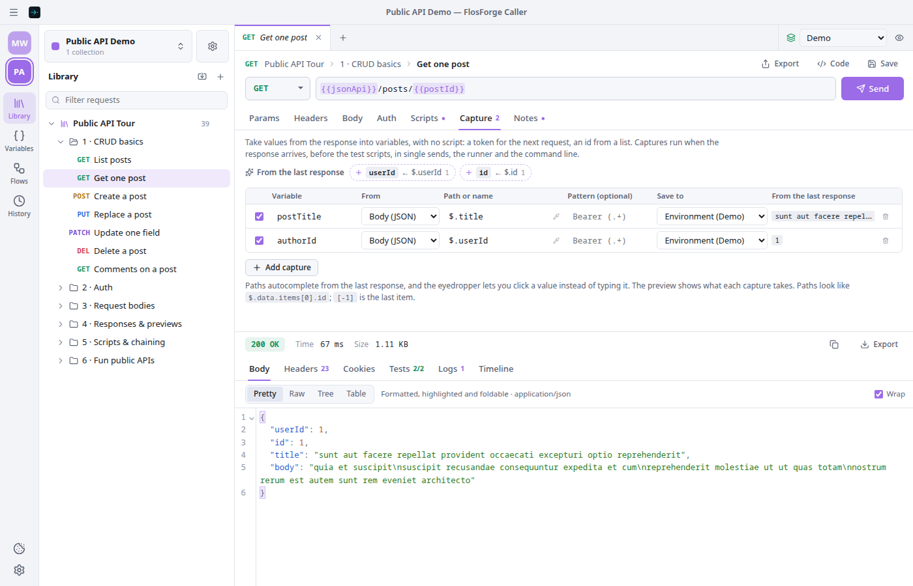
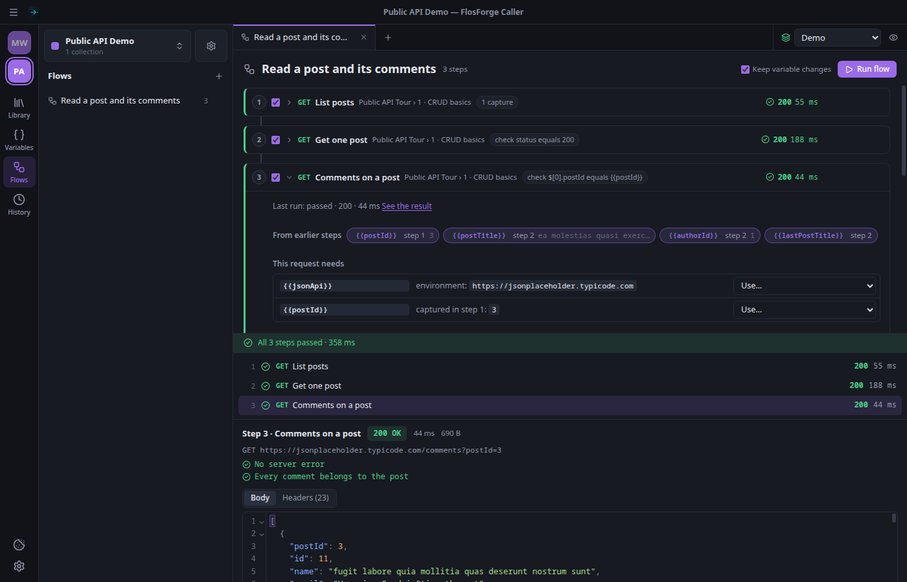
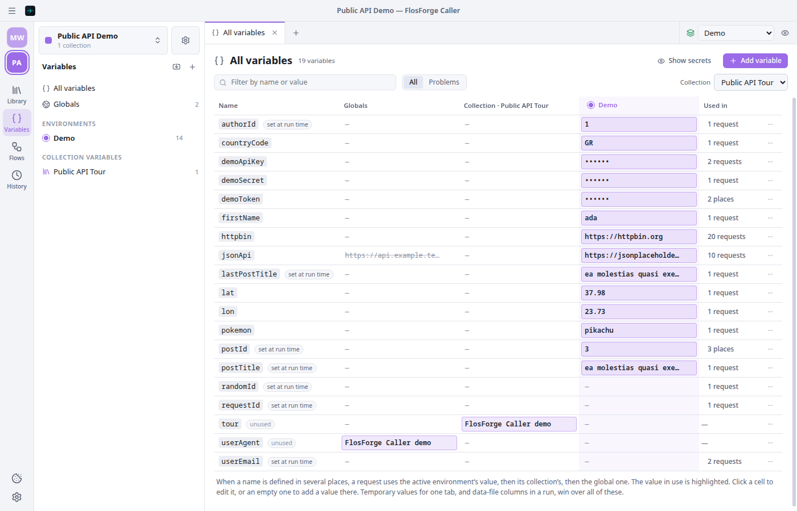

<p align="center">
  
</p>

<h1 align="center">FlosForge Caller</h1>

<p align="center">
  A free, open-source, local-first HTTP API client for Windows, macOS and Linux, from FlosForge.<br/>
  No account. No cloud sync. No telemetry. Opens the collections you already have.
</p>

<p align="center">
  <a href="https://github.com/dimitriostzr/flosforge-http-caller/releases/latest"><b>Download the latest release</b></a> for macOS, Windows and Linux
  · <a href="#build-it-yourself">or build it yourself</a>
</p>

> **A note on this project:** I built FlosForge Caller for my own work and decided to share it openly under the
> GNU GPL v3. It's a personal project, provided as-is. You're welcome to [download it](#get-it), use it, and
> [fork it](#fork-it) to change or extend it however you like. Forking is the way to go: the repository doesn't take
> issues or pull requests.

<p align="center">
  
  
</p>
<p align="center"><sub>Left: capturing values from a response. Right: a flow passing them on, with its results.</sub></p>

## What's new in 0.2

- **[Flows](#flows):** chain requests into a saved flow, with conditions, repeats and checks, and see each step's result.
- **Captures:** take a token or an id from a response into a variable, without writing a script.
- **Variables panel:** every variable in one table: the value in use, problems, where it's used, rename everywhere.
- **Proxies and certificates:** system or custom HTTP and SOCKS proxies, extra and system CA certificates, and client
  certificates for mutual TLS.
- **Path variables and live responses:** `/users/:id` gets its own value table, and server-sent events show as they
  arrive.
- **Safer imports:** an import that carries scripts or file uploads says so before it's saved, and the app asks before
  uploading any file you didn't pick yourself. The command line runs scripts in a separate JavaScript interpreter.

See the [0.2.0 release notes](https://github.com/dimitriostzr/flosforge-http-caller/releases/tag/v0.2.0) for everything.

## Why

Popular API clients started requiring an account for things that used to work offline. FlosForge Caller keeps
the parts I actually use (collections, environments, scripts and tests) and leaves out everything else:

- **Local-first:** everything lives on your computer as plain JSON files, readable and easy to back up.
- **No account:** no sign-up and no login. Open it and start sending requests.
- **No cloud sync:** your collections, environments and secrets never leave your machine.
- **No telemetry:** no analytics, tracking or phoning home. The only network traffic is the requests you send
  (plus, when the proxy is set to System and your computer configures its proxy automatically, the proxy script your
  system points to).
- **No subscriptions:** free and open source under the GNU GPL v3, with nothing to pay and no paid tier.

## Features

- **Requests:** any method, query params synced with the URL, path variables (`/users/:id`, with the value in a
  table under the params), headers (with bulk edit), and these body types:
  - raw JSON, XML, HTML, text or JavaScript
  - multipart form with files
  - URL-encoded form
  - GraphQL
  - a binary file
- **Auth:** Bearer, Basic, API key (header or query) and OAuth 2.0 access token. A request can inherit auth from its
  folder or collection.
- **Variables:** `{{variables}}` from environments, collection variables and globals. They're highlighted as you type,
  show their value on hover and autocomplete. Hover a variable, or Ctrl/⌘+click it, to set its value in the
  environment, collection or globals, or just for the current tab. When you send a request with undefined variables,
  you're asked for them. Dynamic variables like `{{$guid}}`, `{{$timestamp}}` and `{{$randomEmail}}` work too.
- **Variables panel:** globals, environments and collection variables together. **All variables** shows every name
  in one table, with its value in each scope and the value requests actually use highlighted. It flags variables
  that are used but defined nowhere, missing from some environments, or unused, lists where each one is used, and
  renames a variable everywhere in one step. The eye button next to the environment picker shows what each variable
  resolves to for the open tab.
- **Captures:** chain requests without writing a script. Each request's **Capture** tab takes values from the response
  into variables: a body value by JSON path (`$.data.token`, `$.items[-1].id`), a header, a cookie or the status
  code, optionally narrowed with a regular expression. Each capture saves to the environment, the collection, globals
  or the current run only. The last response fills them in for you: it suggests tokens and ids worth capturing,
  autocompletes paths, previews what each capture takes, and in the response's Tree view one click turns any value
  into a capture. Captures run before the test scripts, in single sends, the runner and the command line. Exported
  collections carry them as the equivalent script lines, so they keep working in other API clients.
- **Flows:** chain requests from your library into a saved flow, across collections, with conditions, repeats and
  checks, and a results panel. See [Flows](#flows).
- **Scripts and tests:** pre-request and post-response scripts using the familiar `pm.*` API:
  - `pm.test` and `pm.expect` (chai)
  - `pm.response.to.have.status`, `pm.environment`, `pm.variables`, `pm.sendRequest`
  - `CryptoJS` and lodash `_`
  - the older global script API and `tests[]`

  Scripts run at collection, folder and request level.
- **Responses:**
  - pretty, raw and preview views (HTML and images)
  - JSON as an expandable tree (copy any value, or its path for scripts) or as a sortable, filterable table
  - headers and cookies
  - test results and console logs
  - a timeline with DNS, connect, TLS, wait and download timings, redirects and the exact headers sent
  - live responses: server-sent events (`text/event-stream`) appear one by one as they arrive, and slow or streamed
    bodies show while they download. **Stop** ends a stream and keeps what arrived, and the tests still run on it.
    Event streams aren't cut off by the request timeout
- **Cookie jar:** cookies set by servers are stored and sent automatically. You can view and edit them.
- **Proxies:** the operating system's proxy settings by default (PAC scripts included), or a proxy of your own:
  HTTP (https goes through a CONNECT tunnel) or SOCKS 4, 4a, 5 and 5h, with a username and password and a list of
  hosts that skip it.
- **Certificates:** trust extra CA certificates (PEM or DER) or the ones installed in your operating system (handy
  behind a company proxy that inspects https), and send client certificates for mutual TLS, per host, as PEM files
  or a PKCS#12 bundle.
- **Import:**
  - collections in the Collection Format v2.1, v2.0 and v1
  - environments and globals
  - full data dumps
  - cURL commands (paste one straight into the URL bar)
- **Export:**
  - collections, folders or single requests as Collection v2.1 (opens here and in other API clients), as an exact
    FlosForge Caller file, or a single request as cURL; environments and full backups too
  - responses and runner results as Markdown, plain text, PDF, CSV or JSON (runs also as JUnit XML); a JSON
    list in Table view as CSV. Reports mask authorization, cookie and API-key headers; values in URLs are shown as
    sent
  - code snippets for cURL, fetch, Python `requests`, HTTPie and Go
- **Workspaces:** keep unrelated work apart. Each workspace has its own collections, environments, globals, flows,
  history and open tabs, and its own accent colour, so you can tell at a glance where you are. Pin workspaces to the
  sidebar to switch between them with one click.
- **Themes:** System, Light or Dark, plus 63 painted themes shared with FlosForge Reader (terminal themes included).
  You can also make your own by copying any theme and changing its colours.
- **Collection runner:** run a collection or folder in order, many times or once per row of a CSV/JSON data file,
  with variables flowing from request to request, `setNextRequest` flow control, stop-on-failure and JSON or JUnit
  reports. See [Collection runner](#collection-runner).
- **Command line:** run the same collections in a terminal or CI, with familiar runner flags. See
  [Command line and CI](#command-line-and-ci).
- **Demo workspace:** one click ("Try the demo") sets up a guided tour of 31 requests against two free public
  testing services (JSONPlaceholder and httpbin), with notes and tests on each.
- **Workflow:**
  - tabs, with session restore
  - history
  - drag-and-drop to reorder the library
  - response panel below or beside the request

## Get it

### Download

Ready-made apps are on the **[Releases page](https://github.com/dimitriostzr/flosforge-http-caller/releases/latest)**:

| System | File |
|---|---|
| macOS, Apple Silicon | `FlosForge-Caller-macOS-<version>-arm64.dmg` |
| macOS, Intel | `FlosForge-Caller-macOS-<version>-x64.dmg` |
| Windows (installer) | `FlosForge-Caller-Windows-<version>-x64-setup.exe` (or `arm64`) |
| Windows (no install) | `FlosForge-Caller-Windows-<version>-x64-portable.exe` (or `arm64`) |
| Linux, x64 | `FlosForge-Caller-Linux-<version>-x86_64.AppImage`, `…-amd64.deb` or `…-x86_64.rpm` |
| Linux, ARM64 | `FlosForge-Caller-Linux-<version>-arm64.AppImage`, `…-arm64.deb` or `…-aarch64.rpm` |

The apps aren't signed with a paid Apple or Microsoft certificate, so your system warns you the first time:

- **macOS** (13 Ventura or later): open the app once, then go to **System Settings → Privacy & Security** and click
  **Open Anyway**.
- **Windows:** SmartScreen warns about an unknown publisher. Click **More info**, then **Run anyway**.
- **Linux:** make the AppImage executable (`chmod +x FlosForge-Caller-*.AppImage`) and run it. It needs no extra
  libraries. Or install the `.deb` (Debian, Ubuntu) or `.rpm` (Fedora, openSUSE) with your package manager.

`SHA256SUMS` lists each file's checksum. To check a download, put it in the same folder and run
`sha256sum -c SHA256SUMS --ignore-missing` (on a Mac, `shasum -a 256 -c SHA256SUMS --ignore-missing`).

### Build it yourself

You need [Node.js](https://nodejs.org) 22 or later and git.

```bash
git clone https://github.com/dimitriostzr/flosforge-http-caller.git
cd flosforge-http-caller
npm install
npm run dev            # run it straight away, or package it:
npm run dist:mac       # macOS:   .dmg and .zip (Apple Silicon and Intel) in dist/
npm run dist:win       # Windows: installers and portable .exe in dist/ (on Windows or macOS)
npm run dist:linux     # Linux:   .AppImage, .deb and .rpm in dist/
```

Build each package on its own operating system, with one exception: the Windows packages also build on macOS.

- **macOS:** builds are ad-hoc signed, which Apple Silicon needs before it will start an app, and a copy you build
  yourself opens directly. Copies moved to another Mac get the **Open Anyway** prompt described above.
- **Linux:** building `.deb` and `.rpm` needs `rpm-build` (and on Fedora `libxcrypt-compat`); the AppImage needs
  nothing extra.

## Bringing your collections

1. In the API client you use now, export each collection in the **Collection v2.1** format (v2.0 and v1 work too).
2. Export your environments and globals the same way.
3. If your client can export all your data at once as a single dump file, that works too.
4. In FlosForge Caller, press <kbd>Ctrl/⌘</kbd>+<kbd>O</kbd> or click the import icon in the sidebar, then drop in the files.
   You can import several at once.

What carries over: folders, requests, params (including disabled ones), path variables, headers, all body types,
auth, collection variables, environments (secret values stay masked), and pre-request and test scripts.

Not supported yet: request examples (saved responses), Digest, AWS Signature, Hawk and NTLM auth, and
`pm.visualizer`. The import summary lists anything that was skipped.

When a file you import contains scripts or file uploads, the app tells you before importing it. Import collections only
from people you trust: their scripts run when you send their requests.

### Script compatibility

Most everyday `pm.*` scripts run unchanged. `require()` works for `chai`, `lodash`, `crypto-js` and `uuid`.
`pm.sendRequest` works with both callbacks and `await`.

## Collection runner

Right-click a collection or folder and choose **Run collection…** / **Run folder…**, or press **Run** in its
settings. In the runner tab you can:

- choose which requests run (all by default, in tree order)
- set the number of iterations, or load a **data file** (CSV with a header row, or a JSON array of objects):
  each row is one iteration and its columns become `{{variables}}` and `pm.iterationData`
- add a delay between requests, stop at the first failure, and decide whether variable changes made by scripts are
  kept

Variables set by one request's scripts are visible to the next, so a login request can feed the rest of the flow.
Scripts can steer the run with `pm.execution.setNextRequest("Request name")`, or stop it with
`setNextRequest(null)`. Results stream in live and export as Markdown, text, PDF, CSV, JSON or JUnit XML.

## Flows

A flow is a saved list of steps, each one a request from your library, possibly from different collections. Open
**Flows** in the sidebar, press **+**, and add requests in the order they should run. What a step captures is there for
the steps after it, so a login step's `{{token}}` reaches every request that follows.

Expand a step to:

- see **what its request needs**: every variable it reads and where the value will come from (this step, a capture
  in an earlier step, the environment), with a menu to take one from an earlier step, like `postId ← {{id}}`
- give it **values of its own**, for this step only (run one request twice with different input)
- add **captures** of its own, filled in from the step's last response
- **run it only if** a condition holds, **repeat it until** something holds on the response (polling a job, at most N
  times, with a wait between tries), or add a **check** of its own
- choose whether a failure **stops the flow** or lets it **carry on**

Add **waits** between steps where an API needs time. **Run flow** shows each step's status as it goes. The results
panel, below or beside the steps like a response panel, has each step's URL, captures, tests and response. With
**Keep variable changes** on, what the flow sets is saved to the environment, collections and globals.

Steps run their requests as they're saved in the library, so improving a request improves every flow that uses it.
Flows are part of backups, and run from the command line with `--flow` (see below).

<p align="center">
  
</p>
<p align="center"><sub>The Variables panel: every variable per scope, the value in use highlighted, and where each is used.</sub></p>

## Command line and CI

The `flosforge-caller` command runs collections with the same engine as the app. It needs only Node.js 22+, and
its flags follow the conventions of other collection runners, so existing scripts move over easily:

```bash
flosforge-caller run api.collection.json \
  -e staging.environment.json \
  -d users.csv \
  -r cli,junit --reporter-junit-export results.xml
```

It exits with 0 when everything passed, 1 when a request or test failed, and 2 for usage errors. Run
`flosforge-caller --help` for every option (`--folder`, `--env-var`, `--bail`, `--insecure`, timeouts and more).

To run a flow, export a backup (Settings → Data) and run `flosforge-caller run backup.json --flow "Checkout"`.

Proxies and certificates work there too. The CLI follows `HTTP_PROXY`, `HTTPS_PROXY`, `ALL_PROXY` and `NO_PROXY`,
or takes `--proxy <url>` and `--noproxy <hosts>`. `--ssl-extra-ca-certs`, `--system-ca`, `--ssl-client-cert`,
`--ssl-client-key`, `--ssl-client-pfx` and `--ssl-client-passphrase` cover certificates.

Build it from a clone with `npm run build:cli`. The result in `out/cli/` is standalone: three files, about 1.4 MB,
with every dependency included, so it runs anywhere with Node.js. Run it with `node out/cli/index.cjs run …`, or copy
the folder into another project and run it in CI from there. For example, in GitHub Actions:

```yaml
- uses: actions/setup-node@v4
  with:
    node-version: 22
- name: API tests
  run: node tools/flosforge-caller-cli/index.cjs run tests/api.collection.json -e tests/ci.environment.json -r cli,junit --reporter-junit-export api-results.xml
```

Scripts in a CLI run execute in [QuickJS](https://bellard.org/quickjs/), a separate JavaScript interpreter compiled to
WebAssembly, in a worker that gets an empty environment. They can't reach the process environment, `require`, the
file system or the network (other than through `pm.sendRequest`), so a collection's scripts can't read CI secrets.
Files that requests upload are read from the working directory only (`--working-dir`, the current directory by
default); `--insecure-file-read` lifts that. On GitHub Actions, workflow commands are paused while a run prints, so
output from a collection or its servers can't issue them.

## Your data

Everything lives in plain JSON:

- Linux: `~/.config/FlosForge Caller/data`
- macOS: `~/Library/Application Support/FlosForge Caller/data`
- Windows: `%APPDATA%\FlosForge Caller\data`

Each workspace is a folder under `workspaces/`. Each collection inside it is its own file, with the environments,
globals, flows and history next to them, so the data is easy to back up or keep in a git repo. Set the `FLOSFORGE_CALLER_DATA_DIR` environment variable to keep data elsewhere,
for example a portable install or a synced folder.

## Security

- HTTP requests run in the Electron main process, so there are no browser CORS limits.
- The UI runs with `contextIsolation`, `sandbox` and no Node access. It talks to the main process through a small,
  typed preload API. The packaged app can't be started as plain Node.js and ignores `NODE_OPTIONS` and `--inspect`.
- Scripts run in a dedicated Web Worker with its own Content-Security-Policy. They can't touch your files or the
  app's API, can't make network calls directly (only through `pm.sendRequest`), and a script that hangs is stopped
  after a configurable time limit. What a script changes is checked before it's used: a script can change a
  request's URL, method, headers and text body, never which files it uploads.
- Scripts do see your variables, and `pm.sendRequest` sends with your cookies and client certificates, as in other API
  clients. That's why an import that brings scripts says so first.
- A file is uploaded without asking only if you picked it in the app. A path that came from an imported collection,
  a backup or a pasted cURL command needs your OK first, and system files, devices and network shares are never sent.
- HTML response previews render in a fully sandboxed iframe with no scripts.
- Authorization headers, cookies and API-key headers are dropped when a redirect leads to another host, port or
  scheme. Responses stop at 256 MB, compressed ones included, so a hostile server can't exhaust memory.
- Reports rendered to PDF go through a hidden window with scripts off, a strict Content-Security-Policy and no
  navigation, so nothing in a response can load or reach anything while it prints.
- History keeps each request as you wrote it, with `{{variables}}` unresolved, plus the URL that was actually sent.
  In that URL the values of query parameters named like credentials (`api_key`, `token`, `secret`, `password`,
  `sig` and similar) and the password of `user:pass@host` are masked before the entry is saved.
- A proxy password is sent only to the proxy. It never appears in the request headers shown in the timeline,
  history or reports. On disk, proxy passwords and client-certificate passphrases are encrypted with your operating
  system's keychain (Keychain on macOS, DPAPI on Windows, the desktop keyring on Linux). On a system without one they
  are saved in plain text in `settings.json`, so keep that folder private.
- The list of files you picked for upload (`allowed-files.json`) drops paths that no longer exist each time the app
  starts.

## Keyboard shortcuts

| Action                   | Shortcut                        |
| ------------------------ | ------------------------------- |
| Send request             | <kbd>Ctrl/⌘</kbd>+<kbd>Enter</kbd> |
| Save request             | <kbd>Ctrl/⌘</kbd>+<kbd>S</kbd>     |
| New request              | <kbd>Ctrl/⌘</kbd>+<kbd>N</kbd>     |
| New collection           | <kbd>Ctrl/⌘</kbd>+<kbd>Shift</kbd>+<kbd>N</kbd> |
| Import                   | <kbd>Ctrl/⌘</kbd>+<kbd>O</kbd>     |
| Close tab                | <kbd>Ctrl/⌘</kbd>+<kbd>W</kbd>     |
| Next / previous tab      | <kbd>Ctrl</kbd>+<kbd>Tab</kbd> / <kbd>Ctrl</kbd>+<kbd>Shift</kbd>+<kbd>Tab</kbd> |
| Toggle sidebar           | <kbd>Ctrl/⌘</kbd>+<kbd>B</kbd>     |
| Response below / beside  | <kbd>Ctrl/⌘</kbd>+<kbd>Alt</kbd>+<kbd>L</kbd> |
| Settings                 | <kbd>Ctrl/⌘</kbd>+<kbd>,</kbd>     |

## Development

Requires Node.js 22+.

```bash
npm install          # also downloads Electron on first run
npm run dev          # start with hot reload
npm test             # unit tests (importers, cURL, codegen, HTTP engine, storage, request building)
npm run typecheck
npm run build:cli    # the command-line runner, into out/cli
npm run dist:linux   # or dist:win / dist:mac – packages into ./dist
```

### Project layout

```
src/
  shared/      data model, collection/cURL importers, code generation (runs in main and renderer)
    engine/      request execution, scripts, variables, captures, collection runs, flows, reports (app and CLI)
  cli/         the command-line runner
  main/        Electron main process: window, IPC, JSON storage, HTTP engine, cookie jar
  preload/     the typed bridge exposed to the UI as window.api
  renderer/    React UI
    src/lib/       request preparation, variables, send pipeline, script host
    src/worker/    the script sandbox (pm.* API)
    src/store/     zustand stores and persistence
    src/theme/     theme palettes and the one place they are applied
    src/about/     third-party notices shown in Settings → About (generated)
scripts/       third-party.mjs: builds the notices from the dependency tree (runs before every build)
test/          vitest suites
```

### Building on macOS

`npm install && npm run dist:mac` builds `.dmg` and `.zip` files for Apple Silicon and Intel in `dist/`. The app
is ad-hoc signed (`mac.identity: '-'` in `electron-builder.yml`), which Apple Silicon requires for the app to
start at all. To sign with a Developer ID and notarize instead, set `mac.identity` to your certificate, turn on
`hardenedRuntime`, and follow electron-builder's notarization guide.

## Fork it

FlosForge Caller is free software: you can redistribute it and/or modify it under the terms of the
**[GNU General Public License v3](LICENSE)** as published by the Free Software Foundation, either version 3 of the
License, or (at your option) any later version. Copyright © 2026 Dimitrios Tzortzis.

In plain words:

- **Use it** for anything, including at work, for free.
- **Change it** however you like in your own copy.
- **Share it**, changed or not, only under the same license: whoever gets a copy from you, free or paid, must also
  get the full source code and the same freedoms. Closed-source or rebranded proprietary versions aren't allowed.
- **Name and logo:** the license covers the code, not the FlosForge name or logo. If you publish a fork, give it its
  own name and icon so nobody mistakes it for this project.

Build it, use it, build on it. If it doesn't do what you need, the fix lives in your own copy:

1. Fork the repository (or just download it).
2. Read [Project layout](#project-layout) to see where each part lives.
3. Make it yours.

There's no support channel, and the repository doesn't take issues or pull requests.

## Credits

FlosForge Caller stands on the work of these open-source projects:

- **[Electron](https://www.electronjs.org)** (MIT), with **Chromium** and **Node.js** inside it
- **[React](https://react.dev)** (MIT) and **[zustand](https://github.com/pmndrs/zustand)** (MIT) with
  **[Immer](https://immerjs.github.io/immer/)** (MIT) for the UI and its state
- **[CodeMirror](https://codemirror.net)** and **[Lezer](https://lezer.codemirror.net)** (MIT) by Marijn Haverbeke,
  through **[@uiw/react-codemirror](https://github.com/uiwjs/react-codemirror)** (MIT), for every editor
- **[Lucide](https://lucide.dev)** icons (ISC; some icons from [Feather](https://feathericons.com), MIT)
- **[tough-cookie](https://github.com/salesforce/tough-cookie)** (BSD-3-Clause) for the cookie jar, with
  **[tldts](https://github.com/remusao/tldts)** (MIT) and the **[Public Suffix List](https://publicsuffix.org)**
  (MPL-2.0)
- **[QuickJS](https://bellard.org/quickjs/)** (MIT) by Fabrice Bellard and Charlie Gordon, through
  **[quickjs-emscripten](https://github.com/justjake/quickjs-emscripten)** (MIT), for scripts on the command line
- **[Chai](https://www.chaijs.com)**, **[Lodash](https://lodash.com)** and
  **[crypto-js](https://github.com/brix/crypto-js)** (MIT) inside the script sandbox, for `pm.*` scripts

The full list, with every license text, is in **[THIRD_PARTY_NOTICES.md](THIRD_PARTY_NOTICES.md)** and in the app
under **Settings → About & licenses**. Every copy of the app also carries Electron's, Chromium's and Node.js's
licenses (`LICENSES.chromium.html`).

**Theme palettes:** many painted themes reuse the colours of well-known editor themes, including Nord, Dracula,
Solarized, gruvbox, Tokyo Night, One Dark, Catppuccin, Rosé Pine, Everforest, Ayu, Monokai and others. No code from
them is included; most themes carry names of their own in the app (a few keep the original's), and each original is
credited with its author in
[THIRD_PARTY_NOTICES.md](THIRD_PARTY_NOTICES.md#theme-palettes) and in the app.

## Legal & disclaimers

- **Use at your own risk:** the software is provided under the GNU GPL v3 as-is, without warranty of any kind.
  You are responsible for the requests you send and the systems you send them to. See [LICENSE](LICENSE).
- **Independent project:** FlosForge Caller is an independent open-source project. It is **not affiliated with,
  endorsed by, or sponsored by** any other API tool vendor.
- **Trademarks:** product and company names are trademarks of their respective owners.
- **Public APIs in the demo:** the demo workspace calls two free public testing services (JSONPlaceholder and
  httpbin) that are run by third parties, under their own terms and rate limits.
